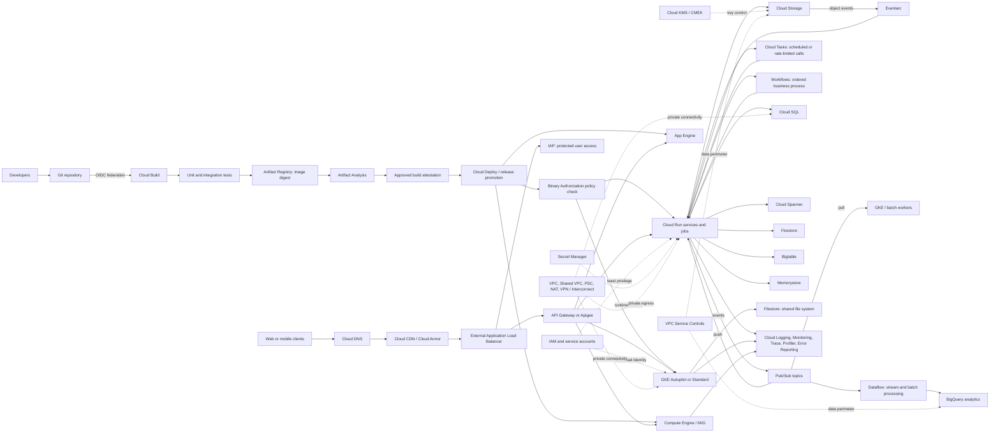

# Google Cloud Professional Cloud Developer (PCD) Master Notes

Consolidated study guide from the six deep-dive volumes and the focused topic notes in this folder. It is organized around architecture decisions, operational trade-offs, and common exam signals rather than repeating each source document.

> **Exam currency:** Product names, quotas, defaults, feature availability, and exam domains change. Treat hard limits in older notes as clues, not universal facts; confirm them against the current official Professional Cloud Developer exam guide and product documentation. On scenario questions, prefer the option that meets the stated requirement with the least operational overhead while preserving security and reliability.

## 1. A Reference Architecture

This example shows how the services in these notes commonly fit together. Not every system needs every box; choose only what the requirements call for. The diagram is Mermaid source and can be extended as your study architecture evolves.

**How to read it:** The delivery path builds and verifies an immutable artifact before deployment. The runtime path separates synchronous requests from asynchronous events and work. Data services are selected by access pattern. IAM, network controls, secrets, and observability apply across the architecture.

## 2. Choose the Runtime

| Requirement | First service to consider | Important trade-off |
| --- | --- | --- |
| Stateless container, HTTP API, webhook, spiky traffic, minimal ops | **Cloud Run** | Request-based scaling; use min/max instances and concurrency deliberately. Direct VPC egress or a Serverless VPC Access connector can reach private resources. |
| Run-to-completion container task or batch operation | **Cloud Run Jobs** | No HTTP listener; suitable for scheduled work and migrations. Use Cloud Scheduler when a cron schedule is required. |
| Kubernetes APIs, custom scheduling, sidecars, service mesh, cluster control | **GKE** | Prefer Autopilot when its constraints fit; choose Standard when node-level control or a feature requires it. |
| Source-oriented PaaS with fast scaling and little infrastructure management | **App Engine Standard** | Runtime sandbox and platform constraints matter; use the supported runtime behavior, not assumptions from another environment. |
| App needs custom OS packages or VM-like environment but remains App Engine-oriented | **App Engine Flexible** | VM-backed and slower to scale; account for baseline instance cost and startup time. |
| OS/kernel control, legacy application, specialized VM configuration, lift-and-shift | **Compute Engine / Managed Instance Groups** | Highest infrastructure responsibility; MIG templates are immutable and updated with rolling updates. |
| Small event-driven function tightly coupled to an event trigger | **Cloud Run functions** (formerly Cloud Functions) | Gen 2 uses Cloud Run and Eventarc infrastructure; make handlers idempotent and check generation-specific behavior. |

### Cloud Run details

- **Concurrency:** Higher concurrency can improve utilization for I/O-bound services; lower it for CPU-heavy or memory-heavy handlers. Size using load tests, not a blanket setting.
- **Scaling and database protection:** Set a service maximum where downstream capacity is finite. Use bounded connection pools; a Cloud SQL Auth Proxy provides secure connectivity but is not itself a general connection pooler.
- **Cold starts:** Minimum instances can reduce startup latency at additional cost. Keep startup work small and measure before pinning instances warm.
- **CPU after response:** Request-based CPU allocation may not suit background work that continues after responding. Configure instance-based CPU allocation when that work is required, or move durable work to Cloud Tasks, Pub/Sub, or a job.
- **Revisions:** Deploy a new revision without ordinary traffic, then direct traffic by revision for canary/rollback. A percentage split is random traffic distribution, not a way to target named beta users; use an application-controlled routing strategy for that requirement.
- **Long-lived connections:** WebSockets and streaming have platform-specific timeouts and scaling behavior. Verify current limits and design reconnect/retry behavior; do not assume any serverless service guarantees an indefinitely pinned connection.
- **Private networking:** Use Direct VPC egress where supported and appropriate, or a Serverless VPC Access connector. Connect privately to Cloud SQL, Memorystore, and other internal endpoints with suitable IAM and firewall configuration.

### GKE essentials

- **Autopilot:** Google manages nodes and much of cluster operations. Pod requests, supported features, and compute classes guide provisioning. GPUs and specialized compute may be available with supported configurations; do not automatically assume Standard is required.
- **Standard:** Use when node pools, node-level agents, privileged workloads, kernel settings, or other explicitly unsupported Autopilot features are required.
- **Workload objects:** Deployment for stateless replicas; StatefulSet for stable identity and persistent state; DaemonSet for one-per-node agents; Job/CronJob for finite/scheduled work.
- **Probes:** Startup probe protects slow initialization and gates other probes; readiness removes an unhealthy pod from service endpoints without restarting it; liveness restarts a stuck container. Avoid making liveness depend on fragile downstream services.
- **Autoscaling:** HPA adjusts replica count; VPA adjusts resource requests; Cluster Autoscaler changes node capacity. Define resource requests. Avoid having HPA and VPA compete over the same utilization signal.
- **Scheduling:** Taints repel, tolerations permit, and node affinity/selectors choose placement. A toleration alone does not force placement. Pod anti-affinity can spread replicas across nodes/zones.
- **Networking:** ClusterIP is internal; NodePort exposes a node port; LoadBalancer provisions a Layer 4 load balancer; GKE Ingress/Gateway can provide Layer 7 routing. Container-native load balancing uses NEGs to target pod endpoints directly where supported.
- **Shared files:** Use Filestore with an appropriate RWX volume when multiple pods need a shared writable filesystem. Use PersistentVolumes/Claims and the correct CSI-backed StorageClass for persistent block storage.
- **NetworkPolicy:** Apply least-access rules intentionally. A default-deny egress policy can also block DNS; allow DNS and required service destinations explicitly.
- **Troubleshooting:** `Pending` points to capacity, scheduling, or PVC binding; `CrashLoopBackOff` calls for current and previous logs plus startup configuration/probe review; no endpoints suggests selector/readiness mismatch; load-balancer 5xx suggests health checks, NEG/backend health, firewall, timeout, or policy issues.

## 3. Messaging and Coordination

| Need | Service | Mental model |
| --- | --- | --- |
| Independent consumers, event fan-out, high-throughput messaging | **Pub/Sub** | Topic plus one or more subscriptions; publishers are decoupled from consumers. |
| Explicit task delivery, delayed execution, strict dispatch rate/concurrency | **Cloud Tasks** | A named target receives a task with retry/backoff and queue controls. |
| Ordered multi-step API process, branching, retries, state passing | **Workflows** | Orchestration across HTTP APIs and Google Cloud services. |
| Route cloud events based on source/type to a destination | **Eventarc** | Event routing, commonly to Cloud Run or Workflows. |
| Complex stream/batch transforms, windows, late data | **Dataflow (Apache Beam)** | Processing engine for event/time-aware pipelines. |

**Pub/Sub rules:** Default delivery semantics are at-least-once, so consumers should be idempotent. Use ordering keys when per-key ordering is needed, and configure a dead-letter topic for repeatedly failing messages. Pull gives workers control over flow; push works well with HTTPS serverless endpoints. Exactly-once capabilities have specific scope and configuration; they do not remove the need for robust processing and deduplication design.

**Cloud Tasks vs. Pub/Sub:** Choose Tasks for a specific deferred HTTP invocation, scheduled dispatch, or explicit rate limiting. Choose Pub/Sub when an event can have multiple independent subscribers or is part of an event stream. Do not use Workflows as a general high-volume queue, or Tasks when broadcast/fan-out is the main requirement.

**Workflows vs. Eventarc:** Workflows controls sequence and decisions. Eventarc reacts to an event and routes it. They can be combined: Eventarc starts a workflow, which then coordinates services.

**Dataflow vs. Dataproc:** Dataflow is a managed Beam runner for custom batch/stream processing and windowing. Dataproc is suited to existing Hadoop/Spark/Hive workloads that should migrate with limited code changes; ephemeral clusters with data in Cloud Storage can reduce idle cost. BigQuery is the analytical warehouse, not a low-latency transactional store.

## 4. Select the Data Service

| Data shape / workload | Service | Key design point |
| --- | --- | --- |
| Regional relational OLTP, familiar MySQL/PostgreSQL/SQL Server | **Cloud SQL** | HA standby provides failover, not read scaling. Read replicas are asynchronous and used for reads; cross-region DR promotion is a separate recovery action. |
| Relational SQL with horizontal/global scale and strong consistency | **Cloud Spanner** | Design keys to distribute writes; avoid monotonically increasing leading keys. Use read-only/stale reads where consistency requirements permit. |
| Web/mobile documents, real-time updates, offline client support | **Firestore** | Model around query patterns; create composite indexes as needed; use transactions for read-dependent writes and batched writes for write-only atomic groups. |
| Very high-throughput sparse wide-column/time-series | **Bigtable** | Row key is central to access and distribution; avoid sequential leading keys/hotspots. Consider reversed timestamps for newest-first range scans. |
| Petabyte analytics and SQL warehousing | **BigQuery** | Partition and cluster for common filters; use authorized views to expose limited data. Batch loads are often economical; streaming has different latency/cost characteristics. |
| Images, files, backups, static assets | **Cloud Storage** | Choose class by access frequency and minimum duration; lifecycle rules manage transitions/deletion; retention policies and Bucket Lock enforce retention. |
| Fast ephemeral key/value cache or session data | **Memorystore (Redis/Memcached)** | Redis provides richer data structures; cache eviction/TTL and persistence/HA requirements matter. It is not durable cart/order storage by default. |
| Shared POSIX/NFS files for multiple GKE pods | **Filestore** | Use where file semantics and shared RWX access are required. |

### Data-specific exam signals

- **Cloud SQL connections:** Autoscaling compute can create more database connections than the database supports. Bound instance counts, use application pools, and consider a pooler for connection multiplexing. Use the Auth Proxy/connector for secure connectivity when appropriate; it does not replace pooling.
- **Spanner hotspots:** Avoid timestamp/sequence as the first primary-key component for high-write workloads. Consider UUIDs, hash prefixes, bit-reversal, or a high-cardinality leading key. Use interleaving only when the parent/child relationship and access pattern benefit from physical co-location; it is not a universal replacement for foreign keys.
- **Firestore contention:** A single hot document can become a write bottleneck. Use sharded/distributed counters for high-rate aggregate updates. Exact limits depend on data model and current service behavior; avoid memorizing a universal per-document rate as a rule.
- **Firestore transactions:** Transaction callbacks can retry, so do not perform non-idempotent external side effects inside them. Perform reads before writes where required by the client/API. Batched writes do not read data.
- **Bigtable:** It is not a relational database and does not provide general multi-row ACID transactions. Design row keys around the queries and write distribution.
- **Cloud Storage access:** Signed URLs grant time-limited access. Signed POST policy documents support browser upload constraints such as content type and size. Use least privilege for the signer and short expirations.
- **Retention:** Lifecycle management changes storage class or deletes based on rules; it does not by itself prevent deletion. A locked retention policy is the compliance control, with careful review before locking.
- **Cloud CDN/browser cache:** CDN invalidation clears edge cache; browser caching is governed by response `Cache-Control` metadata/headers and may need versioned asset names.

## 5. APIs, Edge, and Migration

### API front door

- **API Gateway:** Managed gateway commonly selected for simpler serverless APIs.
- **Cloud Endpoints:** API management with ESP/ESPv2 proxy deployment; consider for supported OpenAPI/gRPC scenarios where a distributed proxy fits.
- **Apigee:** Enterprise API lifecycle, developer portal, products, monetization, analytics, and advanced policies or transformations.
- **Quota vs. SpikeArrest (Apigee):** Quota enforces a consumption allowance over a longer interval; SpikeArrest smooths bursts/rate. Verify exact policy semantics and configuration against current documentation.
- **JWT:** Gateway/proxy can validate configured JWTs using issuer/audience and key-set configuration when supported. Avoid custom signature-validation code if the selected gateway can enforce the requirement natively; confirm configuration syntax for the chosen product.
- **IAP:** Central user identity/access control for supported web applications and resources. Grant the appropriate IAP access role; it does not replace service-to-service IAM.
- **Cloud Armor:** Edge security policy for supported load balancers, including WAF and traffic filtering. It is not an image provenance or deployment control.
- **Cloud CDN:** Edge caching to reduce latency and backend load.

### Migration patterns

- **Rehost:** Move with minimal changes, often to Compute Engine or VMware Engine; fastest, but retains operational burden.
- **Replatform:** Adopt managed infrastructure with limited application changes, such as a database migration to Cloud SQL.
- **Refactor:** Redesign into cloud-native services when the business case justifies the investment.
- **Strangler pattern:** Put a facade/routing layer in front of a monolith, extract bounded capabilities incrementally, route selected paths to new services, and retire the legacy system as coverage grows.
- **Coexistence/data synchronization:** Avoid letting every new service write directly into a shared legacy database. Use clear data ownership and controlled replication/events; Datastream can capture database changes, often feeding Pub/Sub/Dataflow or a target system when supported.
- **Hybrid network:** HA VPN provides encrypted connectivity over the internet; Dedicated/Partner Interconnect provide private connectivity options. Cloud Router exchanges dynamic routes with BGP. Cloud NAT provides outbound internet for private resources; Private Google Access provides access to Google APIs from eligible private instances; Private Service Connect privately consumes supported services.

## 6. Identity, Security, and Networking

- **IAM:** Principal + role + resource binding. Prefer least-privilege predefined roles; use custom roles only when predefined roles do not fit. Avoid basic Owner/Editor/Viewer roles for workloads.
- **Service identities:** Use a dedicated service account per workload and Application Default Credentials. On GKE, use Workload Identity Federation for GKE to let Kubernetes workloads obtain Google credentials without JSON keys. Avoid granting broad node service account permissions.
- **External CI identity:** Use Workload Identity Federation to let GitHub Actions or another OIDC-capable provider impersonate a Google service account temporarily. Do not store long-lived service-account keys in source control or CI secrets.
- **Impersonation:** Grant narrowly scoped token-creation/impersonation permissions to the actor that needs to act as a service account.
- **Secret Manager:** Store runtime secrets and grant access per secret/workload. Do not bake secrets into images, source, manifests, or plain build substitutions. Rotation requires consumer coordination and testing.
- **Cloud KMS/CMEK:** CMEK gives customer control over key lifecycle for supported resources. Envelope encryption uses a data key for payload and a KMS-protected key-encryption key; key access and availability become operational dependencies.
- **VPC Service Controls:** Adds a service perimeter to reduce data exfiltration risk across supported Google APIs. It complements IAM; it does not grant access or replace identity controls. Configure ingress/egress and access levels deliberately.
- **VPC structure:** Custom-mode VPCs offer explicit subnet planning. Shared VPC centralizes network administration across projects. VPC Peering is private VPC-to-VPC connectivity but is not transitive by default.
- **Cloud NAT:** Egress only for eligible private resources; it does not make them reachable from the internet. Firewall policy still matters.
- **Private Service Connect:** Private service consumption using internal addresses for supported producer/consumer services.
- **GKE private access:** Restrict control-plane access using supported authorized networks/private endpoint options and connect administrators through approved corporate connectivity or a controlled bastion path.
- **Defense in depth:** Combine identity, network boundaries, encryption, deployment verification, and runtime monitoring. No single control substitutes for the others.

## 7. Build, Test, and Release

### CI and artifacts

- **Cloud Build:** Containerized steps; `/workspace` is shared across steps. Steps are sequential by default; `waitFor` enables explicit dependencies/parallel work. Use triggers for repository events.
- **Private Pools:** Use when builds need controlled network access or dedicated execution. Configure the supported private-network connection; do not expose private dependencies publicly just to make a build work.
- **Secrets in builds:** Retrieve from Secret Manager using supported integrations and avoid printing or persisting secret values in logs/artifacts.
- **Artifact Registry:** Store container images and language packages. Deploy by immutable digest for reproducibility; tags are convenient labels and may be mutable.
- **Artifact Analysis and Binary Authorization:** Scanning identifies known vulnerabilities; pipeline policy decides whether to fail. Binary Authorization verifies attestations at deployment for supported targets. A scan alone does not prove that the exact deployed artifact passed an approved build.
- **Cloud Deploy:** Promote releases across targets/environments. Choose rollout strategy and approval gates based on risk; use monitoring signals and a defined rollback path.

### Deployment patterns

- **Rolling update:** Gradual replacement, usually efficient but rollback/traffic control depends on platform.
- **Canary:** Shift a small amount of traffic to a new version, observe errors/latency, then continue or roll back. Cloud Run supports revision traffic allocation. GKE can use Gateway/API or service-mesh traffic weights; replica-ratio routing is approximate, not a precise per-request percentage guarantee.
- **Blue/green:** Keep old and new environments available, then switch routing; costs more but makes rollback fast.
- **Shadow testing:** Duplicate production requests to a candidate without using its responses for users; protect side effects and sensitive data.
- **App Engine:** Services/versions and traffic splitting support controlled releases. `app.yaml` configures a service; `dispatch.yaml` routes paths/services; `cron.yaml` defines scheduled HTTP invocations. `index.yaml` applies to Datastore-mode indexing. Legacy `queue.yaml` task queues are distinct from modern Cloud Tasks.

### Developer inner loop and tests

- **Cloud Code + Skaffold:** IDE support and a repeatable Kubernetes build/deploy loop (`skaffold dev`) reduce manual rebuild and redeploy work.
- **Cloud Run local test:** Build and run the container locally. **Functions Framework** provides a local HTTP server for function handlers and mock event payloads.
- **Emulators:** Commonly used for Pub/Sub, Firestore, Bigtable, and Spanner integration tests. Point client libraries at the emulator using the documented environment variables. Emulators do not guarantee identical production behavior; keep a smaller set of cloud integration tests when needed.
- **Cloud SQL local test:** Use a local database container or a development database, rather than expecting a Cloud SQL emulator.
- **Cloud Build CI tests:** Start an emulator/service dependency, run isolated tests, then tear it down. Use the Spanner emulator for fast CI tests where appropriate, while recognizing that performance and production behavior still need cloud validation.
- **Terraform:** Use remote state and locking where supported. Cloud Storage object versioning helps recover prior state objects; protect state because it can contain sensitive values. Kustomize bases/overlays can manage environment-specific Kubernetes manifests.

## 8. Observability and Troubleshooting

| Question | Tool |
| --- | --- |
| What happened and what did the application log? | **Cloud Logging** |
| Is the service healthy; alert on metrics/SLOs? | **Cloud Monitoring** |
| Where did one request spend time across services? | **Cloud Trace** |
| Which code path uses CPU or memory? | **Cloud Profiler** |
| Which exceptions are recurring and grouped? | **Error Reporting** |
| Need Prometheus metrics without operating Prometheus servers? | **Managed Service for Prometheus** |

- **Log/trace correlation:** Emit structured logs and the documented trace field in the expected full resource format so log entries can be associated with traces. Confirm exact field spelling and format in current Logging documentation.
- **Log cost:** Use exclusions for unwanted stored logs and log-based metrics where applicable. Verify processing order/metric behavior for the selected metric type before relying on an exclusion for cost savings.
- **Alerting:** Define the metric, alignment window, reducer, threshold, duration, and notification channel to match the symptom. Avoid noisy alerts on transient single samples.
- **GKE checklist:** Check pod events/resources/probes; inspect logs including the previous container; verify labels/selectors/readiness; inspect PVC binding; then check NEG/backend health, load-balancer health checks, firewall, timeout, and Cloud Armor/IAP configuration.
- **Cloud SQL connection exhaustion:** Bound Cloud Run/GKE replica growth and per-instance pool size; add a suitable pooler if necessary. Raising DB limits alone may postpone rather than solve the scaling mismatch.
- **Cloud Run latency after idle:** Measure cold starts; reduce startup work or configure minimum instances if latency justifies the cost.
- **HTTP 504:** Identify which hop times out (client, gateway, load balancer, service). Increase the correct supported timeout only after checking whether the operation should instead be asynchronous.

## 9. Rapid Exam Decision Rules

1. **Start from the constraint:** minimize operations, scale to zero, global writes, existing Spark, custom kernel, fixed API rate, or strict retention often determines the product.
2. **Separate availability from scale:** Cloud SQL HA is failover; replicas scale reads. Spanner is relational horizontal scale. Bigtable is high-throughput wide-column. BigQuery is analytics.
3. **Separate durable work from request lifecycle:** Pub/Sub for event fan-out; Tasks for targeted delayed/rate-controlled calls; Workflows for explicit multi-step coordination; Jobs for run-to-completion compute.
4. **Assume retries and duplicates:** Make event handlers and transaction callbacks safe to retry; isolate external side effects.
5. **Protect downstream capacity:** Bound autoscaling and connection pools; queues can buffer bursts, but consumers still need controlled concurrency.
6. **Use keyless identity:** ADC for Google runtimes, Workload Identity for GKE, Workload Identity Federation for external CI. Avoid downloaded JSON keys.
7. **Protect both build and runtime:** scan artifacts, attest the exact digest, enforce Binary Authorization where required, and use runtime least privilege.
8. **Optimize the actual access pattern:** indexes for Firestore/Spanner; row keys for Bigtable; partitioning/clustering for BigQuery; lifecycle/retention for Cloud Storage.
9. **Know the control boundary:** IAM is identity authorization; IAP is user access to supported apps; VPC-SC is API data perimeter; Cloud Armor filters edge traffic; NetworkPolicy controls pod traffic.
10. **For migrations, minimize risk:** rehost when time dominates; replatform for managed operations; refactor for cloud-native goals; use Strangler routing for incremental replacement.

## 10. Source Notes Consolidated

The following source files remain unchanged and can be used for deeper topic-specific examples:

- [Compute and cloud-native architecture](gcp_pcd_deep_dive_vol_1_compute.md)
- [Data storage, caching, and state management](gcp_pcd_deep_dive_vol_2_data_storage.md)
- [Messaging, orchestration, and API management](gcp_pcd_deep_dive_vol_3_messaging_apis.md)
- [GKE master notes](gcp_pcd_deep_dive_vol_4_gke.md)
- [Security, IAM, networking, and encryption](gcp_pcd_deep_dive_vol_5_security_net.md)
- [CI/CD, DevOps, and software supply chain](gcp_pcd_deep_dive_vol_6_cicd_supply_chain.md)
- [API management](txt/API%20Management.md)
- [Caching and content delivery](txt/Caching%20Strategies%20%26%20Content%20Delivery.md)
- [CI/CD](txt/CD%20and%20CI.md)
- [Cloud migration](txt/Cloud%20Migration.md)
- [Data processing](txt/Data%20Processing.md)
- [Firestore](txt/firestore.md)
- [GKE networking, identity, and security](txt/GKE%20Networking%2C%20Identity%2C%20%26%20Security.md)
- [IAM](txt/IAM.md)
- [Local and Cloud Code testing](txt/Local%20%26%20Cloud%20Code%20Testing.md)
- [Monitoring](txt/monitoring.md)
- [Serverless compute](txt/Serverless%20Compute.md)
- [Cloud Spanner](txt/spanners.md)
- [Storage](txt/Storage.md)
- [Testing, troubleshooting, and deployment](txt/Testing%2C%20Troubleshooting.md)